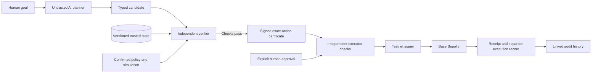

# Vallet

**An AI financial planner with independently checked authority to act.**

[Submission guide](docs/SUBMISSION.md) · [Deployment](docs/DEPLOYMENT.md) · [Tests](docs/TESTING.md) · [Documentation](docs/README.md) · [CI](https://github.com/akiibot/proofFi/actions/workflows/ci.yml)

Formerly ProofFi. See [rename compatibility](docs/BRANDING.md) for preserved technical identifiers and historical references.

Vallet separates financial intelligence from financial authority. The planner proposes; policy, simulation and an independent verifier decide whether an exact action may receive a signed certificate. Explicit human approval and independent executor checks precede testnet signing.

The single-user MVP supports all three browser scenarios: goal to proposal, safe amount, certificate, approval, confirmed Base Sepolia execution and linked audit; controlled malicious-planner rejection; and emergency expense with stale evidence and a lower safe amount. The [acceptance matrix](docs/ACCEPTANCE_MATRIX.md) distinguishes isolated CI from genuine chain evidence. See the single [remaining MVP checklist](docs/PROGRESS.md).

## Review in five minutes

1. Open the [submission guide](docs/SUBMISSION.md) for the problem, three scenarios and evidence.
2. View the [recorded walkthrough](evidence/prooffi-browser-walkthrough.webm) and [latest captured hosted screens](evidence/pf-049-hosted-readonly/README.md). Captures identify their source revision; the older walkthrough predates the redesigned UI.
3. Try the [hosted preview](https://prooffi-preview.vercel.app) with owner-provided demo access, or run the clean-checkout steps below. Credentials are deliberately absent from GitHub; free hosting may cold-start.
4. Inspect the [acceptance matrix](docs/ACCEPTANCE_MATRIX.md), [test guide](docs/TESTING.md) and [known limitations](docs/KNOWN_LIMITATIONS.md).

## How it works



The verifier reloads trusted inputs and recomputes checks; the planner cannot approve or sign. The executor validates again before calling the signer. See the [full architecture and data diagram](docs/ARCHITECTURE.md) and [certificate format](docs/CERTIFICATES.md).

## Repository map

| Path | Purpose |
|---|---|
| `apps/web/` | Next.js product UI, same-origin API proxy and Playwright tests |
| `services/api/` | FastAPI modules, policy/simulation/planner, verification/execution and Python tests |
| `contracts/` | Generated OpenAPI contract; generated TypeScript consumer stays in the web app |
| `services/api/migrations/`, `services/api/postgres_migrations/` | Separate SQLite and PostgreSQL migration histories |
| `scripts/` | Locked bootstrap, validation and guarded operator tooling |
| `docs/` | Architecture, deployment, tests, presentation and operational guidance |
| `evidence/` | Public evidence, recordings and revision-specific validation metadata |

## Clean checkout

Install Git, Python **3.11**, Node **22.19.0** (`.nvmrc`) and npm **10.9.3**.

```sh
git clone https://github.com/akiibot/proofFi.git vallet
cd vallet
python3.11 scripts/bootstrap.py
npm run dev
```

On native Windows use `py -3.11 scripts/bootstrap.py`; subsequent npm commands are the same. Bootstrap installs locked dependencies, creates private local credentials, runs real migrations and seeds missing data. It preserves an existing `.env`, password and database. Open **http://127.0.0.1:3000** and sign in with ignored `.local/demo-password.txt`. API documentation is at **http://127.0.0.1:8000/docs**.

A fresh checkout deliberately has no active policy, simulation selection, wallet, signer or LLM credentials. It reads the original $12,000 synthetic baseline. Missing operational inputs refuse explicitly; setup does not grant financial authority. Configure backend-only inputs using [trusted issuance](docs/TRUSTED_ISSUANCE.md), [chain configuration](docs/CHAIN.md), [authentication](docs/AUTHENTICATION.md) and [planner configuration](docs/PLANNER_OPERATING_EVIDENCE.md). Never put secrets in `NEXT_PUBLIC_*`, browser storage, prompts or GitHub. Only the executor calls the transaction signer.

```sh
# Stop local app servers first; tests own ports 3000 and 8000.
npx playwright install chromium
npm run check
```

On Linux use `npx playwright install --with-deps chromium`. The check runs backend tests and Ruff, generated-contract checks, frontend lint/typecheck/build and serial browser/API/database journeys. Its public test credentials and loopback chain fixture are isolated from runtime credentials and real RPC. A fixture CONFIRMED result is not a genuine on-chain transfer. Native Ubuntu and Windows CI run the full command. [Fresh-checkout evidence](evidence/acceptance-fresh-checkout.json) records the independent setup and validation; historical developer hydration observations remain in [#60](https://github.com/akiibot/proofFi/issues/60).

## Reproduce the funded synthetic scenario

The original baseline has $12,000 cash, $7,000 protected tuition, $2,000 reserve and $3,200 living costs, no income: **-$200 before fees and shocks**. It cannot support a positive allocation. The explicitly selected alternative adds $5,000 synthetic cash, preserving baseline version 1 and appending funded version 2. The hypothetical risk inputs are visible in [funded-demo-config.json](docs/funded-demo-config.json); they are illustrative, not calibrated forecasts.

```sh
# Preview only: no database or policy changes.
.venv/bin/python scripts/provision_funded_demo.py --config docs/funded-demo-config.json
# After selecting these exact assumptions, create a NEW private directory and destination.
python -c "from pathlib import Path; Path('.local/my-isolated-demo').mkdir(mode=0o700, parents=True, exist_ok=False)"
.venv/bin/python scripts/provision_funded_demo.py --config docs/funded-demo-config.json --database .local/my-isolated-demo/scenario.db --confirm-digest d966ea53f445fdf948fc92a174d07db425aba90753d5c7683279a47f85d30314
```

Use `.venv\Scripts\python.exe` on Windows. Select that new database explicitly in the backend `DATABASE_URL`; keep the original database and private configuration. Provisioning never overwrites a destination or activates policy. In the Constitution screen review and confirm the exact rules separately, including the configured Base Sepolia token and recipient restrictions. A login, selected assumptions or a planner proposal never approves a transfer. A new transfer or expense requires its own exact human authorization.

Demo reset uses the existing authenticated `POST /demo/reset`, or the guarded local CLI below. It restores the recorded funded snapshot as a new version, keeps the active policy and all history, and refuses **every database containing execution history**, including confirmed/failed attempts. For such a database create a new isolated stage instead. No reset of the preserved genuine demos was performed.

```sh
# Preview only; --confirm is required to append a reset.
.venv/bin/python scripts/reset_demo.py
.venv/bin/python scripts/reset_demo.py --confirm
```

## Evidence and walkthrough

The [2m50s raw browser tour](evidence/prooffi-browser-walkthrough.webm) shows the earlier UI inspecting genuine confirmed A, the recorded C expense, live replanning to $799, controlled refusal and linked audit. Its [provenance](evidence/current-walkthrough.json) identifies the source revision and inspection copies. The original databases remain byte-identical; the tour authorizes no new financial action. The original exact A execution and C expense evidence are linked separately in the [evidence index](evidence/README.md).

The genuine A transaction is [0xd13c…378d on Base Sepolia](https://sepolia.basescan.org/tx/0xd13c41c1141b22ab3604978582ee5643a06a9b83af360f8de8d76b7e46ad378d). It transferred 2,000 test tokens, linked to its exact certificate and approval; it is not an investment or yield product. The signed certificate expires after five minutes; historical confirmed execution remains separately visible. The [demo script](docs/DEMO_SCRIPT.md), [10-minute presentation outline](docs/PRESENTATION_OUTLINE.md) and [submission evidence](docs/SUBMISSION_CHECKLIST.md) describe the supported claims and limits.

## Development

| Task | Command |
|---|---|
| Start web and backend with root private environment | `npm run dev` |
| Migrate | `.venv/bin/python -m alembic upgrade head` |
| Preserve existing data and seed missing baseline | `PYTHONPATH=services/api .venv/bin/python -m app.db.seed` |
| Backend tests | `.venv/bin/python -m pytest -q` |
| Generate contracts | `npm run contracts` |
| Check schema drift | `.venv/bin/python -m alembic check` |
| Full validation | `npm run check` |

Read [CONTRIBUTING.md](CONTRIBUTING.md), [architecture](docs/ARCHITECTURE.md), [decisions](docs/DECISIONS.md) and the assigned issue before changes. Codex owns the remaining Farid/Wasik implementation work under akiibot lead review. Keep planner, risk, product UI and execution boundaries. PRs, current passing CI and sensitive/shared lead review remain required. This is single-user testnet software with local and hosted deployment paths; advanced recovery is tracked in [#99](https://github.com/akiibot/proofFi/issues/99).
