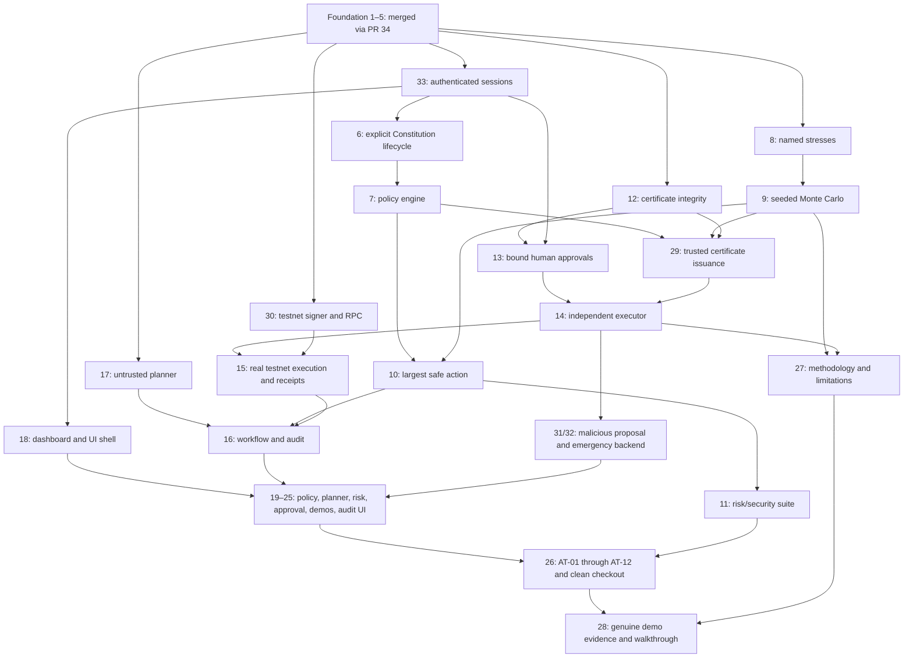

# ProofFi team checklist and delivery flow

Start here before every work session. GitHub Issues contain the implementation requirements, owned paths, acceptance criteria and tests. This checklist is the shared overview; a checked box means **checked and merged into main with acceptance evidence**, not merely implemented on a branch. Follow the issue's current blockers and comments if this snapshot becomes stale.

## Team lanes

| Person | Owns | Immediate next action | Next implementation after dependencies merge |
|---|---|---|---|
| Akib / @akiibot | Foundation, shared contracts/database, verification, approvals, execution, integration | Prepare #44 and #35 for protected review; provision testnet infrastructure | #29 trusted issuance, then finish #14/#15 executor and #16 orchestration |
| Farid / @Alfa5nm | Policy, risk simulation, optimizer, planner, backend demo scenarios | Review existing Constitution PR #41 and stress PR #43; start ready #17 without duplicating them | #17 planner; #9 Monte Carlo after #8; #7 policy after #6 |
| Wasik / @WasikZubair | Product UI, browser tests and demo walkthrough | Review #44 and read the setup guides in #39 | #18 dashboard after foundation + #33; then #19 Constitution UI |
| All three | #26 end-to-end acceptance | Own one coordinated test/integration effort; lead is accountable | Farid risk tests, Wasik browser tests, Akib security/chain tests |

Assignments identify the accountable owner, not permission to ignore dependencies. Temporary assistant implementations remain in issue-linked PRs for the named owner to review and take over. Post the branch/PR on the issue before coding so nobody duplicates active work.

## Current integration checkpoint

- Foundation #34 is merged into main at `9c49ef4815023c746b3c18556fe5963918731f2b`; #1–#5 are closed. The owner extended the teammate-approval waiver to future PRs on 2026-10-16. PRs, strict current `foundation` CI, dependency checks and lead review of sensitive/shared changes remain required.
- Both teammates have accepted write access; actual issue assignments are verified, including all three on #26. Farid's latest published implementation is #42, merged through #34. No newer teammate branch/PR was present at this audit; unpublished work is unknown.
- Farid's state/auth fixes are propagated through the implementation stack. Preserve session/CSRF auth in #45 and descendants; do not restore prototype bearer authentication.
- Merged implementation PRs: #35 certificates, #36 signer/RPC, #45 authentication and #38 approvals. Open implementation PRs: #39 onboarding, #40 execution claim guards, #41 Constitution lifecycle and #43 named stresses. Teammate approvals are optional; each PR still needs current checks and applicable lead review.
- Current stack order: **#40 → #41 → #43**; #39 is independent documentation. This is branch ancestry, not permission to bypass issue prerequisites: #40 cannot complete #14 before #29 trusted issuance. Retarget each child to main only after its base lands, refresh and rerun CI. #44 is merged documentation.
- Foundation-only dependencies are satisfied for #8, #12, #17, #30 and #33. Existing PRs should be reviewed rather than rebuilt; #17 is ready for Farid. #18 still requires #33. Other issues retain their specific unmerged dependencies.
- Latest full implementation-stack local check FAILED: 184 backend tests passed; browser/API tests had 3 passed / 1 failed on the PF-033 five-second login redirect assertion. The earlier 184/4 passing checkpoint remains historical; the timing root cause is unresolved. Separate #44 and #35 full local/hosted checks passed. Fresh #44 evidence is in docs/TEST_RESULTS.md.
- No actual testnet infrastructure or genuine receipt exists. Public execution remains disabled; #40 is claim guards only. No approved probabilistic config or invented income: the literal budget stays $200 short before shocks/fees.

## Delivery flow

This is the high-level flow. The exact prerequisite list is on each issue and in the checklist below; an arrow does not replace those gates. All feature lanes depend on the reviewed foundation. Auth #33 additionally gates policy confirmation, dashboard, approvals and execution.

## Central issue checklist

Foundation boxes reflect merged #34 and closed #1–#5. All feature boxes remain open. **Blocked** means an additional issue dependency remains unmerged; foundation prerequisites are satisfied. **PR available** means review/take over that code instead of recreating it. PF-014 has guards only; signing and full executor integration remain incomplete.

### Akib / @akiibot

- [x] **PF-001 — [Repo bootstrap and reliable local startup](https://github.com/akiibot/proofFi/issues/1)** · Merged via #34; [PR #34](https://github.com/akiibot/proofFi/pull/34). Dependencies: None.
- [x] **PF-002 — [Trust boundaries, shared domain models and API contracts](https://github.com/akiibot/proofFi/issues/2)** · Merged via #34; [PR #34](https://github.com/akiibot/proofFi/pull/34). Dependencies: None.
- [x] **PF-003 — [Database schema, migrations, state versioning and seed fixture](https://github.com/akiibot/proofFi/issues/3)** · Merged via #34; [PR #34](https://github.com/akiibot/proofFi/pull/34). Dependencies: None.
- [x] **PF-004 — [Chain/transaction design, environment and secret-handling boundary](https://github.com/akiibot/proofFi/issues/4)** · Merged via #34; [PR #34](https://github.com/akiibot/proofFi/pull/34). Dependencies: None.
- [x] **PF-005 — [GitHub workflow, CI checks, issue templates, PR template and contributor docs](https://github.com/akiibot/proofFi/issues/5)** · Merged via #34; [foundation PR #34](https://github.com/akiibot/proofFi/pull/34), [onboarding PR #39](https://github.com/akiibot/proofFi/pull/39). Dependencies: None.
- [x] **PF-012 — [Canonical certificate payload, hashing and signature primitives](https://github.com/akiibot/proofFi/issues/12)** · Merged via [PR #35](https://github.com/akiibot/proofFi/pull/35). Dependencies: [#1](https://github.com/akiibot/proofFi/issues/1), [#2](https://github.com/akiibot/proofFi/issues/2), [#3](https://github.com/akiibot/proofFi/issues/3), [#4](https://github.com/akiibot/proofFi/issues/4), [#5](https://github.com/akiibot/proofFi/issues/5).
- [x] **PF-013 — [Approval binding and authorization lifecycle](https://github.com/akiibot/proofFi/issues/13)** · Merged via [PR #38](https://github.com/akiibot/proofFi/pull/38). Dependencies: [#1](https://github.com/akiibot/proofFi/issues/1), [#2](https://github.com/akiibot/proofFi/issues/2), [#3](https://github.com/akiibot/proofFi/issues/3), [#4](https://github.com/akiibot/proofFi/issues/4), [#5](https://github.com/akiibot/proofFi/issues/5), [#12](https://github.com/akiibot/proofFi/issues/12), [#33](https://github.com/akiibot/proofFi/issues/33).
- [ ] **PF-014 — [Independent executor, replay and concurrency guards](https://github.com/akiibot/proofFi/issues/14)** · Guards only; incomplete / blocked; [PR #40](https://github.com/akiibot/proofFi/pull/40). Dependencies: [#1](https://github.com/akiibot/proofFi/issues/1), [#2](https://github.com/akiibot/proofFi/issues/2), [#3](https://github.com/akiibot/proofFi/issues/3), [#4](https://github.com/akiibot/proofFi/issues/4), [#5](https://github.com/akiibot/proofFi/issues/5), [#13](https://github.com/akiibot/proofFi/issues/13), [#29](https://github.com/akiibot/proofFi/issues/29), [#33](https://github.com/akiibot/proofFi/issues/33).
- [ ] **PF-015 — [Connect authorized executor to real EVM testnet and store receipt](https://github.com/akiibot/proofFi/issues/15)** · Blocked. Dependencies: [#1](https://github.com/akiibot/proofFi/issues/1), [#2](https://github.com/akiibot/proofFi/issues/2), [#3](https://github.com/akiibot/proofFi/issues/3), [#4](https://github.com/akiibot/proofFi/issues/4), [#5](https://github.com/akiibot/proofFi/issues/5), [#14](https://github.com/akiibot/proofFi/issues/14), [#30](https://github.com/akiibot/proofFi/issues/30).
- [ ] **PF-016 — [Workflow orchestrator, audit trail and exact execution link](https://github.com/akiibot/proofFi/issues/16)** · Blocked. Dependencies: [#1](https://github.com/akiibot/proofFi/issues/1), [#2](https://github.com/akiibot/proofFi/issues/2), [#3](https://github.com/akiibot/proofFi/issues/3), [#4](https://github.com/akiibot/proofFi/issues/4), [#5](https://github.com/akiibot/proofFi/issues/5), [#10](https://github.com/akiibot/proofFi/issues/10), [#15](https://github.com/akiibot/proofFi/issues/15), [#17](https://github.com/akiibot/proofFi/issues/17).
- [ ] **PF-029 — [Bind independent policy/simulation checks to certificate issuance](https://github.com/akiibot/proofFi/issues/29)** · Blocked. Dependencies: [#1](https://github.com/akiibot/proofFi/issues/1), [#2](https://github.com/akiibot/proofFi/issues/2), [#3](https://github.com/akiibot/proofFi/issues/3), [#4](https://github.com/akiibot/proofFi/issues/4), [#5](https://github.com/akiibot/proofFi/issues/5), [#7](https://github.com/akiibot/proofFi/issues/7), [#9](https://github.com/akiibot/proofFi/issues/9), [#12](https://github.com/akiibot/proofFi/issues/12).
- [x] **PF-030 — [Isolated testnet-only signing and RPC adapter](https://github.com/akiibot/proofFi/issues/30)** · Merged via [PR #36](https://github.com/akiibot/proofFi/pull/36). Dependencies: [#1](https://github.com/akiibot/proofFi/issues/1), [#2](https://github.com/akiibot/proofFi/issues/2), [#3](https://github.com/akiibot/proofFi/issues/3), [#4](https://github.com/akiibot/proofFi/issues/4), [#5](https://github.com/akiibot/proofFi/issues/5).
- [x] **PF-033 — [Authenticated demo session and browser mutation boundary](https://github.com/akiibot/proofFi/issues/33)** · Merged via [PR #45](https://github.com/akiibot/proofFi/pull/45), replacing stale-base #37. Dependencies: [#1](https://github.com/akiibot/proofFi/issues/1), [#2](https://github.com/akiibot/proofFi/issues/2), [#3](https://github.com/akiibot/proofFi/issues/3), [#4](https://github.com/akiibot/proofFi/issues/4), [#5](https://github.com/akiibot/proofFi/issues/5).

- [ ] **PF-026 — [End-to-end acceptance tests AT-01 to AT-12 and fresh-checkout run](https://github.com/akiibot/proofFi/issues/26)** · Shared; Akib accountable, Farid risk tests, Wasik browser tests; blocked. Dependencies: [#1](https://github.com/akiibot/proofFi/issues/1), [#2](https://github.com/akiibot/proofFi/issues/2), [#3](https://github.com/akiibot/proofFi/issues/3), [#4](https://github.com/akiibot/proofFi/issues/4), [#5](https://github.com/akiibot/proofFi/issues/5), [#16](https://github.com/akiibot/proofFi/issues/16), [#20](https://github.com/akiibot/proofFi/issues/20), [#22](https://github.com/akiibot/proofFi/issues/22), [#23](https://github.com/akiibot/proofFi/issues/23), [#24](https://github.com/akiibot/proofFi/issues/24), [#11](https://github.com/akiibot/proofFi/issues/11), [#19](https://github.com/akiibot/proofFi/issues/19), [#21](https://github.com/akiibot/proofFi/issues/21), [#25](https://github.com/akiibot/proofFi/issues/25), [#33](https://github.com/akiibot/proofFi/issues/33).

### Farid / @Alfa5nm

- [ ] **PF-006 — [Constitution draft, explicit confirm and immutable versions](https://github.com/akiibot/proofFi/issues/6)** · Review available; [PR #41](https://github.com/akiibot/proofFi/pull/41). Dependencies: [#1](https://github.com/akiibot/proofFi/issues/1), [#2](https://github.com/akiibot/proofFi/issues/2), [#3](https://github.com/akiibot/proofFi/issues/3), [#4](https://github.com/akiibot/proofFi/issues/4), [#5](https://github.com/akiibot/proofFi/issues/5), [#33](https://github.com/akiibot/proofFi/issues/33).
- [ ] **PF-007 — [Deterministic policy engine and approval-vs-deny verdicts](https://github.com/akiibot/proofFi/issues/7)** · Blocked. Dependencies: [#1](https://github.com/akiibot/proofFi/issues/1), [#2](https://github.com/akiibot/proofFi/issues/2), [#3](https://github.com/akiibot/proofFi/issues/3), [#4](https://github.com/akiibot/proofFi/issues/4), [#5](https://github.com/akiibot/proofFi/issues/5), [#6](https://github.com/akiibot/proofFi/issues/6).
- [ ] **PF-008 — [Named stress scenarios](https://github.com/akiibot/proofFi/issues/8)** · Review available; [PR #43](https://github.com/akiibot/proofFi/pull/43). Dependencies: [#1](https://github.com/akiibot/proofFi/issues/1), [#2](https://github.com/akiibot/proofFi/issues/2), [#3](https://github.com/akiibot/proofFi/issues/3), [#4](https://github.com/akiibot/proofFi/issues/4), [#5](https://github.com/akiibot/proofFi/issues/5).
- [ ] **PF-009 — [Seeded Monte Carlo and risk metrics](https://github.com/akiibot/proofFi/issues/9)** · Blocked. Dependencies: [#1](https://github.com/akiibot/proofFi/issues/1), [#2](https://github.com/akiibot/proofFi/issues/2), [#3](https://github.com/akiibot/proofFi/issues/3), [#4](https://github.com/akiibot/proofFi/issues/4), [#5](https://github.com/akiibot/proofFi/issues/5), [#8](https://github.com/akiibot/proofFi/issues/8).
- [ ] **PF-010 — [Largest-safe-action optimizer](https://github.com/akiibot/proofFi/issues/10)** · Blocked. Dependencies: [#1](https://github.com/akiibot/proofFi/issues/1), [#2](https://github.com/akiibot/proofFi/issues/2), [#3](https://github.com/akiibot/proofFi/issues/3), [#4](https://github.com/akiibot/proofFi/issues/4), [#5](https://github.com/akiibot/proofFi/issues/5), [#7](https://github.com/akiibot/proofFi/issues/7), [#9](https://github.com/akiibot/proofFi/issues/9).
- [ ] **PF-011 — [Risk backend security and acceptance test suite](https://github.com/akiibot/proofFi/issues/11)** · Blocked. Dependencies: [#1](https://github.com/akiibot/proofFi/issues/1), [#2](https://github.com/akiibot/proofFi/issues/2), [#3](https://github.com/akiibot/proofFi/issues/3), [#4](https://github.com/akiibot/proofFi/issues/4), [#5](https://github.com/akiibot/proofFi/issues/5), [#7](https://github.com/akiibot/proofFi/issues/7), [#10](https://github.com/akiibot/proofFi/issues/10).
- [ ] **PF-017 — [Structured goal parsing and untrusted planner adapter](https://github.com/akiibot/proofFi/issues/17)** · Ready for Farid; foundation merged. Dependencies: [#1](https://github.com/akiibot/proofFi/issues/1), [#2](https://github.com/akiibot/proofFi/issues/2), [#3](https://github.com/akiibot/proofFi/issues/3), [#4](https://github.com/akiibot/proofFi/issues/4), [#5](https://github.com/akiibot/proofFi/issues/5).
- [ ] **PF-027 — [Simulation methodology, API documentation and threat notes](https://github.com/akiibot/proofFi/issues/27)** · Blocked. Dependencies: [#1](https://github.com/akiibot/proofFi/issues/1), [#2](https://github.com/akiibot/proofFi/issues/2), [#3](https://github.com/akiibot/proofFi/issues/3), [#4](https://github.com/akiibot/proofFi/issues/4), [#5](https://github.com/akiibot/proofFi/issues/5), [#9](https://github.com/akiibot/proofFi/issues/9), [#14](https://github.com/akiibot/proofFi/issues/14).
- [ ] **PF-031 — [Controlled malicious planner fixture and red-team backend route](https://github.com/akiibot/proofFi/issues/31)** · Blocked. Dependencies: [#1](https://github.com/akiibot/proofFi/issues/1), [#2](https://github.com/akiibot/proofFi/issues/2), [#3](https://github.com/akiibot/proofFi/issues/3), [#4](https://github.com/akiibot/proofFi/issues/4), [#5](https://github.com/akiibot/proofFi/issues/5), [#7](https://github.com/akiibot/proofFi/issues/7), [#14](https://github.com/akiibot/proofFi/issues/14), [#17](https://github.com/akiibot/proofFi/issues/17).
- [ ] **PF-032 — [Emergency expense backend, state version bump and repricing route](https://github.com/akiibot/proofFi/issues/32)** · Blocked. Dependencies: [#1](https://github.com/akiibot/proofFi/issues/1), [#2](https://github.com/akiibot/proofFi/issues/2), [#3](https://github.com/akiibot/proofFi/issues/3), [#4](https://github.com/akiibot/proofFi/issues/4), [#5](https://github.com/akiibot/proofFi/issues/5), [#10](https://github.com/akiibot/proofFi/issues/10), [#14](https://github.com/akiibot/proofFi/issues/14).

### Wasik / @WasikZubair

- [ ] **PF-018 — [Next.js UI shell, state dashboard and generated API client](https://github.com/akiibot/proofFi/issues/18)** · Blocked. Dependencies: [#1](https://github.com/akiibot/proofFi/issues/1), [#2](https://github.com/akiibot/proofFi/issues/2), [#3](https://github.com/akiibot/proofFi/issues/3), [#4](https://github.com/akiibot/proofFi/issues/4), [#5](https://github.com/akiibot/proofFi/issues/5), [#33](https://github.com/akiibot/proofFi/issues/33).
- [ ] **PF-019 — [Constitution Builder UI and diff/confirmation](https://github.com/akiibot/proofFi/issues/19)** · Blocked. Dependencies: [#1](https://github.com/akiibot/proofFi/issues/1), [#2](https://github.com/akiibot/proofFi/issues/2), [#3](https://github.com/akiibot/proofFi/issues/3), [#4](https://github.com/akiibot/proofFi/issues/4), [#5](https://github.com/akiibot/proofFi/issues/5), [#6](https://github.com/akiibot/proofFi/issues/6), [#18](https://github.com/akiibot/proofFi/issues/18).
- [ ] **PF-020 — [Agent Workspace and candidate/optimizer results](https://github.com/akiibot/proofFi/issues/20)** · Blocked. Dependencies: [#1](https://github.com/akiibot/proofFi/issues/1), [#2](https://github.com/akiibot/proofFi/issues/2), [#3](https://github.com/akiibot/proofFi/issues/3), [#4](https://github.com/akiibot/proofFi/issues/4), [#5](https://github.com/akiibot/proofFi/issues/5), [#10](https://github.com/akiibot/proofFi/issues/10), [#17](https://github.com/akiibot/proofFi/issues/17), [#18](https://github.com/akiibot/proofFi/issues/18).
- [ ] **PF-021 — [Time Machine chart and transparent assumptions UI](https://github.com/akiibot/proofFi/issues/21)** · Blocked. Dependencies: [#1](https://github.com/akiibot/proofFi/issues/1), [#2](https://github.com/akiibot/proofFi/issues/2), [#3](https://github.com/akiibot/proofFi/issues/3), [#4](https://github.com/akiibot/proofFi/issues/4), [#5](https://github.com/akiibot/proofFi/issues/5), [#9](https://github.com/akiibot/proofFi/issues/9), [#18](https://github.com/akiibot/proofFi/issues/18).
- [ ] **PF-022 — [Certificate details, approval panel and execution results UI](https://github.com/akiibot/proofFi/issues/22)** · Blocked. Dependencies: [#1](https://github.com/akiibot/proofFi/issues/1), [#2](https://github.com/akiibot/proofFi/issues/2), [#3](https://github.com/akiibot/proofFi/issues/3), [#4](https://github.com/akiibot/proofFi/issues/4), [#5](https://github.com/akiibot/proofFi/issues/5), [#13](https://github.com/akiibot/proofFi/issues/13), [#15](https://github.com/akiibot/proofFi/issues/15), [#18](https://github.com/akiibot/proofFi/issues/18).
- [ ] **PF-023 — [Red-team demo mode and blocked-executor evidence](https://github.com/akiibot/proofFi/issues/23)** · Blocked. Dependencies: [#1](https://github.com/akiibot/proofFi/issues/1), [#2](https://github.com/akiibot/proofFi/issues/2), [#3](https://github.com/akiibot/proofFi/issues/3), [#4](https://github.com/akiibot/proofFi/issues/4), [#5](https://github.com/akiibot/proofFi/issues/5), [#18](https://github.com/akiibot/proofFi/issues/18), [#31](https://github.com/akiibot/proofFi/issues/31).
- [ ] **PF-024 — [Emergency expense and replanning UI](https://github.com/akiibot/proofFi/issues/24)** · Blocked. Dependencies: [#1](https://github.com/akiibot/proofFi/issues/1), [#2](https://github.com/akiibot/proofFi/issues/2), [#3](https://github.com/akiibot/proofFi/issues/3), [#4](https://github.com/akiibot/proofFi/issues/4), [#5](https://github.com/akiibot/proofFi/issues/5), [#18](https://github.com/akiibot/proofFi/issues/18), [#32](https://github.com/akiibot/proofFi/issues/32).
- [ ] **PF-025 — [Audit Explorer and public-safe certificate verifier UI](https://github.com/akiibot/proofFi/issues/25)** · Blocked. Dependencies: [#1](https://github.com/akiibot/proofFi/issues/1), [#2](https://github.com/akiibot/proofFi/issues/2), [#3](https://github.com/akiibot/proofFi/issues/3), [#4](https://github.com/akiibot/proofFi/issues/4), [#5](https://github.com/akiibot/proofFi/issues/5), [#16](https://github.com/akiibot/proofFi/issues/16), [#18](https://github.com/akiibot/proofFi/issues/18), [#12](https://github.com/akiibot/proofFi/issues/12).

- [ ] **PF-028 — [Demo evidence, README and end-to-end presentation walkthrough](https://github.com/akiibot/proofFi/issues/28)** · Wasik accountable, lead review; blocked. Dependencies: [#1](https://github.com/akiibot/proofFi/issues/1), [#2](https://github.com/akiibot/proofFi/issues/2), [#3](https://github.com/akiibot/proofFi/issues/3), [#4](https://github.com/akiibot/proofFi/issues/4), [#5](https://github.com/akiibot/proofFi/issues/5), [#26](https://github.com/akiibot/proofFi/issues/26), [#27](https://github.com/akiibot/proofFi/issues/27).

## Daily contribution loop

1. Open your assigned issue, read its blockers, existing PR and owned paths. Review an existing implementation before creating another.
2. Take the next ready issue in your lane. If blocked, review prerequisite PRs, improve its test plan or coordinate a documented stacked branch with the lead. Do not remove blocked labels merely because a branch exists.
3. Pull current main; create one `codex/pf-###-description` branch per issue. Keep your own local database, `.env` and credentials. Do not rebuild shared models, routes or foundation.
4. Add meaningful focused tests and implement the issue. Run those tests during development and `npm run check` before review. Report exact failures; fixture chain results are not live receipts.
5. Open an issue-linked PR with scope, test evidence and dependencies. Teammate approval is optional under the owner waiver; shared contracts, migrations and sensitive authorization/execution changes still require lead review. Never fabricate approval or bypass failing CI.
6. After checked merge into main, record the PR/commit/evidence on the issue; close only when its acceptance criteria are met. Tick this checklist, update the detailed backlog/progress and clear a dependent issue's blocked label only after all dependencies actually land.

## Final delivery gates — all three own the outcome

- [ ] Scenario A: calculated safe amount, signed certificate, explicit required approval, real Base Sepolia transfer and confirmed receipt/audit evidence; otherwise display honest no-safe-action and retain the positive-demo blocker.
- [ ] Scenario B: compromised planner proposes the attack; real verifier/executor refuses with no unauthorized signing and records evidence.
- [ ] Scenario C: real $2,000 expense updates versioned state, stale certificate fails, and safe allocation is recomputed or no-safe-action is explained.
- [ ] AT-01..AT-12 pass with actual evidence, including parameter tamper, replay/concurrency, policy confirmation and key isolation.
- [ ] A teammate can clone main, bootstrap, start both services and use the full UI with documented local configuration.
- [ ] Genuine testnet transaction/receipt/explorer evidence exists; no invented hashes, probabilities, income or success states.

Foundation guides are on main; onboarding and testnet guides remain on their implementation branches: [architecture](https://github.com/akiibot/proofFi/blob/main/docs/ARCHITECTURE.md), [decisions](https://github.com/akiibot/proofFi/blob/main/docs/DECISIONS.md), [full backlog](https://github.com/akiibot/proofFi/blob/main/docs/ISSUE_BACKLOG.md), [team setup](https://github.com/akiibot/proofFi/blob/codex/pf-005-developer-instructions/docs/onboarding/START_HERE.md), [Farid](https://github.com/akiibot/proofFi/blob/codex/pf-005-developer-instructions/docs/onboarding/FARID.md), [Wasik](https://github.com/akiibot/proofFi/blob/codex/pf-005-developer-instructions/docs/onboarding/WASIK.md), [testnet checklist](https://github.com/akiibot/proofFi/blob/codex/pf-014-independent-executor/docs/TESTNET_SETUP_CHECKLIST.md). After integration, use the corresponding files on main.
