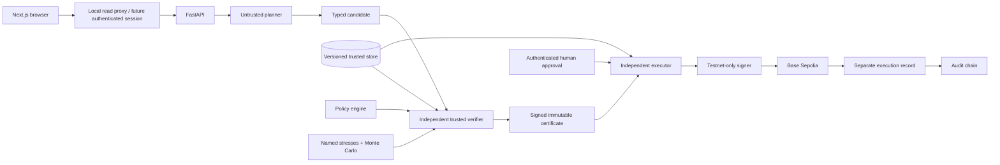
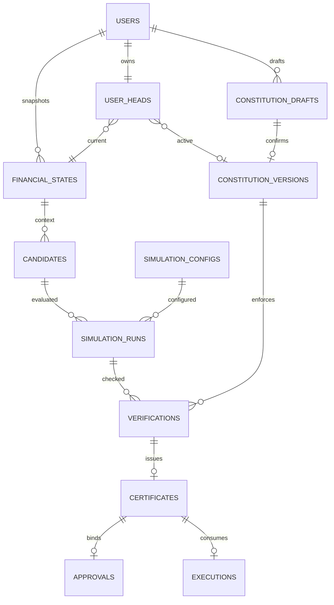

# Architecture and trust boundaries

Lead-approved v1 foundation; approval record in DECISIONS.md. One user, one testnet wallet, one primary goal, three scenarios. This implementation includes persistent state and interface scaffolding only.

Planner code cannot import verifier, approval or execution modules. It only returns validated CandidateAction data. Public `/simulate` and `/verify` accept a candidate; trusted state/policy/config are loaded by backend services, never accepted as user authority. `TrustedSimulationInput` is an internal-only schema.

## Persistence and consistency

Financial snapshots embed AssetBalance, Goal, Obligation, RecurringExpense and ExpectedIncome with stable IDs. SQL artifact records have primary IDs, creation times and FK links. `UserHead` holds authoritative current state and active policy. `append_state(session, snapshot, expected_version)` writes a new immutable snapshot and compare-and-swaps the head in the caller's transaction. Old snapshots remain available; stale writers fail with CONFLICT. Snapshot digest is recomputed when read. Direct DBA writes can corrupt data; this is not tamper-proof storage.

Policy confirmation must create an immutable version and atomically switch active head. The seed never creates a confirmed version. Simulation configs are immutable versioned trusted artifacts; none is selected before assumptions are approved. Certificate nonce/hash and execution certificate/idempotency key are unique. PF-014 must implement atomic claim and approval consumption; constraints alone are not the full executor.

## Action lifecycle contract

1. Planner produces exact cents, token, recipient and chain but no authority.
2. Verifier reloads current snapshot, confirmed Constitution, trusted config and chain context; recomputes rules/risk and constructs an exact transaction.
3. Certificate binds action digest, transaction bytes/nonce/fee caps, state/policy hashes, complete simulation evidence, approval requirement and expiry.
4. Authenticated approval binds one certificate/action/state/policy; never overrides hard failures.
5. Executor independently checks all evidence then atomically claims the certificate. It signs exactly once, preserves pending ambiguous broadcasts and reconciles.
6. Confirmed receipt drives exactly-once planning ledger adjustment. Revert/reorg/timeout must remain visible. The original signed payload is unchanged.
7. Audit events connect all artifacts. Hash sequencing detects ordinary changes but cannot resist a compromised database administrator rewriting the chain.

## Module interfaces and ownership

Canonical data: `app/models/contracts.py`; persistence: `app/db/models.py`; encoding: `app/core/canonical.py`; signing boundary: `app/execution/interfaces.py`; routes: each module's `router.py`. Never implement another developer's module in the frontend or add competing local schemas. See OWNERSHIP.md and published issues.

Foundation read route implementation lives in `app/main.py`; future feature handlers already belong to their respective modules. The protected global router registration requires auth. Service modules may communicate through typed functions, but only execution may call a signer. Independent verification means recomputation and authority separation, not an extra microservice or independence from a compromised host.
