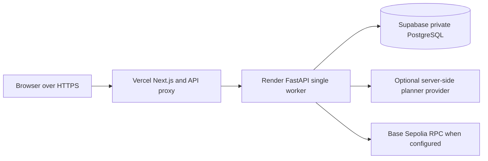

# Deployment guide

Use [local setup](../README.md#clean-checkout) for the fastest reproducible review. The hosted path uses the existing Next.js proxy on Vercel, one FastAPI process on Render and private PostgreSQL on Supabase. The steps below describe a new installation; the dated sections afterward record the existing deployment, not defaults to copy into another account.

## Deployment topology

## New installation sequence

1. Select a reviewed repository commit with passing current CI. Run the [test guide](TESTING.md) in a disposable checkout before deployment.
2. Create a dedicated PostgreSQL database/project. Follow the reviewed [PostgreSQL storage contract](POSTGRES_STORAGE_CONTRACT.md): application tables use `prooffi_private`; do not expose them through a public Data API. For Supabase use its session pooler on port 5432 and verified TLS with the documented public CA. The transaction pooler on 6543 is refused.
3. Create a Render Python web service using [render.yaml](../render.yaml). Preserve its locked build command, direct launcher, health path and single-worker behavior. Add the private backend variables below through provider settings. The launcher validates settings, applies the PostgreSQL migration history, seeds only missing baseline data and starts the API. Do not run the SQLite migration command against this database.
4. Create the Vercel frontend from `apps/web`, enable workspace sources outside the root and use Node 22.x. Set server-side `API_BASE_URL` to the backend HTTPS URL. Once the frontend URL is known, set the backend `TRUSTED_ORIGINS` to exactly that HTTPS origin. Redeploy changed configuration explicitly.
5. Verify `/health`, frontend login, protected reads, cookie flags, Origin/CSRF refusal and logout. Restart the backend deliberately and verify session revocation plus unchanged state/history after logging in again. Do not perform a transfer, expense or reset as a deployment smoke test.

### Environment placement

| Setting | Location and requirement |
|---|---|
| `API_BASE_URL` | Vercel server environment; backend HTTPS base URL |
| `DATABASE_URL` | Render only; `postgresql+psycopg` with `sslmode=verify-full` and `sslrootcert=config/supabase-prod-ca-2021.crt`; construct privately with SQLAlchemy URL utilities |
| `DEMO_PASSWORD_HASH` | Render only; a dedicated salted scrypt hash in the existing authentication format, generated privately using the [authentication provisioning flow](AUTHENTICATION.md) in a separate local setup |
| `TRUSTED_ORIGINS` | Render; JSON array containing the exact frontend HTTPS origin, without a trailing slash |
| `DEPLOYMENT_MODE`, `COOKIE_SECURE` | Render; `public` and `true` |
| `DEMO_MODE`, `EXECUTION_ENABLED` | New hosted baseline: both `false` |
| `SIGNER_PRIVATE_KEY` | Absent while execution is disabled; startup refuses a staged signer key in that mode |
| Planner/verification/chain configuration | Backend only; separate explicit setup in [planner evidence](PLANNER_OPERATING_EVIDENCE.md), [trusted issuance](TRUSTED_ISSUANCE.md) and [chain guidance](CHAIN.md) |

Never place passwords, database URLs, signer/provider keys or private local databases in Vercel client variables, GitHub, build logs or uploaded evidence. Do not copy the existing deployment's wallet, credentials or financial approvals. A new installation starts with an inactive policy and unconfigured operational inputs; successful startup alone does not produce the funded demo or authorize an action.

### Operational checks and troubleshooting

| Observation | Check |
|---|---|
| First request is slow | Free Render may cold-start; check provider health before treating it as an application failure |
| Database unavailable | Check project inactivity pause, session-pooler endpoint, verified TLS and CA path; retain TLS verification |
| Login rejected after deployment | Check dedicated password/hash pairing, exact trusted HTTPS origin and Secure cookies; inspect errors without logging credentials |
| Session lost after restart | Expected: sessions are in memory in one API process; sign in again |
| Positive proposal unavailable | The baseline is deliberately short of protected needs; review explicit [funded scenario setup](FUNDED_DEMO_SETUP.md) and required backend inputs |
| Rollback needed | Retain the database and audit history; choose a previously reviewed compatible application commit. Review migration compatibility before rollback; never reset or drop an operational store to make a deployment pass |

Free service policies and availability can change. Consult provider dashboards at deployment time. The dated evidence below records observed behavior rather than an uptime guarantee.

## Existing deployment and historical evidence

### Vercel + Render Free + Supabase Free (PF-047 / #120)

Runtime integration #122 is approved, merged at3b9fe98 and deployed on the reviewed
PF-046 storage contract (#121, merge9e95a25). The Vercel/Render preview now uses
Supabase persistence. The initial ephemeral SQLite deployment completed under
#117 was exported before switching. Original private local A/B/C databases,
wallets, credentials and genuine evidence are never uploaded.

## Exact deployment shape

- Vercel frontend: `https://prooffi-preview.vercel.app`, Next.js root `apps/web`,
  Node22.x, workspace sources outside the root enabled. Only server-side
  `API_BASE_URL=https://prooffi-preview-api.onrender.com`; no database/signer keys.
- Existing Render backend: `prooffi-preview-api`, **Free**, one API process, no
  persistent disk or paid database. Build `pip install uv==0.13.1 && uv sync --locked --no-dev`.
  Start command: `.venv/bin/python -u scripts/render_postgres.py`.
  Health: `/health`; auto-deploy stays off. `render.yaml` records the configuration.
- New Supabase Free project: `prooffi-testnet`, Ohio, project `iwbwcuttltepreiapnoa`.
  PostgreSQL17.11. Data API disabled; SSL enforcement enabled and verified after
  managed restart. Use the dashboard's **session** pooler on port5432 for IPv4;
  the transaction pooler on port6543 is refused by the reviewed adapter.
- Store application tables and the immutable signed-byte journal only in
  `prooffi_private`. Existing session/CSRF authentication stays in FastAPI;
  Supabase Auth/client libraries do not replace it.

## Private connection and startup

Only Render receives `DATABASE_URL`, using `postgresql+psycopg`,
`sslmode=verify-full` and `sslrootcert=config/supabase-prod-ca-2021.crt`.
Construct the URL with SQLAlchemy URL utilities so password characters are encoded
correctly. Never paste the value into GitHub/chat, process arguments or Vercel.
Keep the existing dedicated hosted `DEMO_PASSWORD_HASH` and exact HTTPS origin
`TRUSTED_ORIGINS=["https://prooffi-preview.vercel.app"]`, with
`DEPLOYMENT_MODE=public`, `COOKIE_SECURE=true`, Python3.11.14 and uv0.13.1.

The checked-in certificate is the public CA downloaded from the Supabase project's
Database Settings link:
`https://supabase-downloads.s3-ap-southeast-1.amazonaws.com/prod/ssl/prod-ca-2021.crt`.
File SHA256: `700723581420dd1ac98fd7e9ac529f0ef210eadcaf87fc868a3ad7d114c2f3b7`.
No private key is included. Default-trust TLS failed locally; the dashboard CA
made full certificate/hostname validation pass. Verification must stay enabled.

`render_postgres.py` validates public auth/TLS and explicit execution settings,
then runs the separate PG migration history and idempotent seed under the approved
transaction lock before starting one worker. It never confirms a policy, selects
probabilities, records expenses or executes a transfer. If execution is false, it
refuses a transaction signing key. Execution true requires explicit server-only
configuration and retains all existing independent verifier/approval/executor gates.

## Fresh initialization and financial boundaries

The owner delegated selection of the existing funded synthetic profile for this
new, still-empty Supabase database. The selected file is
`docs/funded-demo-config.json`; selection digest:
`d966ea53f445fdf948fc92a174d07db425aba90753d5c7683279a47f85d30314`.
It records $17,000 synthetic starting cash, no income, unchanged tuition/reserve/
living obligations,1000 paths over120 days (seed18421),2% daily volatility,20%
probability of an additional $2,000 emergency and a $1 synthetic planning fee.
These are illustrative inputs, not calibrated forecasts or actual assets.

After reviewed runtime merge, use the existing `provision_funded_demo` service in
one locked transaction on the **new empty** PG store, verifying the exact selection
digest first. It keeps baseline v1, appends funded v2, selects that exact config and
leaves the Constitution unconfirmed. Do this before first startup's baseline seed;
subsequent idempotent seeds preserve it. Refuse existing user/config/audit/history
rather than transforming an operational database. Do not import local private DBs.
Before switching Render, recheck/export its disposable preview state: stop for any
unexpected state/policy/audit change rather than silently discarding user work.

Initial hosted settings remain `DEMO_MODE=false`, `EXECUTION_ENABLED=false`, with
no signer key. Durable PG removes the temporary-storage blocker; actual hosted
execution still requires reviewed signing readiness, dedicated testnet configuration,
explicit policy activation and exact per-action approval. No policy activation,
expense, reset, token funding or transfer is authorized by the database selection.
No LLM credentials or deterministic planner mode are silently configured.

## Evidence and remaining gates

The PG suite reuses meaningful existing policy/approval/signing/dispatch/receipt/
workflow/emergency assertions against actual PG database fixtures. Chain adapters
remain isolated tests, not genuine transfers. The inherited reset fixture is
explicitly adapted for PG; its five status guards use FK-complete history instead
of bypassing constraints through SQLite's native connection. Existing SQLite
assertions remain unchanged. Both ordinary CI jobs and PG CI must pass on the PR head.

An isolated real-PG browser journey verified login/dashboard, API restart revoking
the session, reauthentication and exact same canonical state hash/balances after
restart. No financial mutation or active policy was used in that journey.

Hosted validation must check actual health, login/Secure/HttpOnly/Strict cookie,
protected reads, Origin/CSRF rejection, logout/session revocation and state/config/
policy/history hashes across a deliberate backend restart. Account for Free Render
cold starts (~1minute), sessions lost on restart and Supabase Free inactivity pause
(currently1week); data persistence does not make either free service always-on.
No keep-alive workaround or paid upgrade is part of this deployment.

Keep the single remaining migration/deployment checklist in
[#119](https://github.com/akiibot/proofFi/issues/119), with implementation/integration/
evidence/owner decisions distinguished. #120 closes only after actual hosted
integration evidence and any remaining signing decisions are recorded honestly.

## Hosted rollout evidence, 2026-10-18

Runtime #122 merged at3b9fe98 after owner approval and all three current CI jobs
passed (638 backend/95 browser on each OS;299 real PG tests). Supabase migration
and the selected synthetic profile were provisioned in the new database only.
All14 application tables have RLS; anon/authenticated/service_role cannot access
the private schema. Original local demos were preserved.

The first Render rollout dep-dbabtjlg1s2s73bhj4dg reported Live, but actual protected
reads still returned baseline v1/$12,000 and logs showed the old preview launcher.
This was rejected as hosted acceptance. The exact cause of that inconsistent
rollout is unresolved; do not claim a proven uv defect.

With the installed virtualenv Python directly launching the same reviewed script,
dep-dbac3k67bikc73e2gakg became healthy in1m27s. Actual Vercel-proxied authentication,
secure cookies, Origin/CSRF refusals, logout and protected reads passed. Genuine
browser dashboard showed funded v2/$17,000, inactive policy and snapshot hash
`d17754200d0bb9e28fc1e598b9f1010f83750e3229dc87bb4f884b5eba456877`.
No policy activation, expense, reset or transfer occurred. The deployment blueprint
uses the verified direct launcher to reproduce the working configuration.

An actual Render restart launched a new process (pwdgs -> z8hcx), revoked the old
browser session and preserved exact protected-response snapshots after a fresh
login: financial state/hash, draft, inactive policy/history, provision audit and
chain readiness. Independent HTTPS checks passed secure cookies, authenticated
reads, Origin/CSRF refusal and logout before and after restart. This proves
persistence of the current selected profile, not a new cloud transfer. Execution
and chain signing remain unconfigured/disabled pending separate owner decisions.

## Hosted execution acceptance, 2026-10-18

The owner subsequently approved a dedicated new Base Sepolia wallet, its verifier
keys, the existing live Vertex Express planner key, exact testnet provisioning,
and the existing Constitution rules. Each approval was separate from storage
selection; the original issuer key stayed local. Render applies Save-only
settings only after an explicit deployment. The working reviewed source is
67c8597, deploy dep-dbaddotg1s2s73bmdphg; DEMO_MODE stays false.

Required optimizer settings are OPTIMIZER_GAS_LIMIT=62374 and
OPTIMIZER_MAX_FEE_PER_GAS_WEI=11000000, matching the approved transaction bounds.
Both dedicated private-key values must contain exactly 64 lowercase hexadecimal
characters with no trailing newline. Owner credential entry initially included
newlines; trusted certificate issuance refused them. The owner corrected both
fields and their exact identities/lengths were privately verified before redeploy.
No key material belongs in this document, browser bundles or Vercel settings.

The actual browser journey used live AI candidate generation and an independent
optimizer: $2,000 maximum,24 checks, next cent rejected. The owner generated,
approved and executed cert-16a53880-aabd-4c6f-b0f9-441256292973 in the UI.
Two earlier certificates expired without approval/execution; no expiry was extended.
The single transaction 0xa748c4875ba7d7e0fd04528ffe35803c562ff532bec791ae70e44741d2a8f462
confirmed in block48284502. Its exact sender/token/recipient/calldata/amount/nonce/
gas/fee caps match the signed certificate; canonical receipt and exact Transfer
log validation passed. The initial receipt reconciliation returned UNAVAILABLE;
its cause remains unresolved. The retained request and matching recorded claim
subsequently reconciled that same hash. No re-sign or resend occurred.

Private PG evidence contains one consumed approval, one claim/signature/envelope/
dispatch reservation and one ledger effect. State v2 -> v3 debits200100 synthetic
cents (including the approved simulation fee), retaining1499900 liquid cents and
one200000-cent allocation. All18 audit hashes validate. See public artifacts
[evidence/hosted-browser-execution.json](../evidence/hosted-browser-execution.json),
[certificate](../evidence/hosted-action-certificate.json) and
[actual receipt](../evidence/hosted-chain-receipt.json).

Actual hosted isolation checked five private values against five HTML pages,
four authenticated API responses and twelve production assets: no matches.
The session cookie remained Secure/HttpOnly/Strict. This check does not claim
a hosted log scan. Original local genuine A/B/C acceptance remains preserved;
no duplicate cloud expense or reset is needed for this deployment evidence.

After confirmation, an actual Render restart (lz4cv ->67bqb;9:31 PM Dhaka event)
revoked the old browser session. The certificate, execution and retained identity,
immutable envelope metadata, consumed approval, financial state and complete
18-event audit compared exactly equal afterward. Canonical successful receipt
remained present with191 confirmations. No second execution or ledger effect
was created. See [restart evidence](../evidence/hosted-execution-restart.json).

## Figma v2 integration rollout, 2026-10-19

Owner-approved #129 merged at c3942926af4ca178840ad69e7c135c934a96c951 and
deployed first to the existing Render service as dep-dbakofc9v7es738tddb0.
The authenticated read-only execution endpoint passed against the existing
recorded execution. No reconciliation, signer call or dispatch was requested.

#130's final head250acbe passed Ubuntu, Windows and PostgreSQL
[CI](https://github.com/akiibot/proofFi/actions/runs/39173475889), then merged
as e944d002d01af64598131c06eaa54bf832b0c35c. A clean git archive of that exact
merge,454 uploaded files with private workspace paths excluded, built successfully
on Vercel. Deployment dpl_DiAni96MivjEhTSGg5LMyPjhQGqh was promoted to
https://prooffi-preview.vercel.app after READY. Backend application code is
identical between c394292 and e944d002, so no second backend rollout was needed.
Existing project, free service, environment and credentials were retained.

Actual browser reads and HTTPS preservation/security checks passed. All15 private
database table snapshots are exact before/after; statev3/hash, policy/draft/history,
three certificates, execution and20 audit events are unchanged. No new live
financial action occurred. See [hosted evidence and explicit validation limits](../evidence/pf-049-hosted-readonly/README.md).

Previous frontend deployment for rollback:
https://prooffi-preview-2gjx3wpq7-akiiibots-projects.vercel.app
(dpl_HDKJTVZDWPwebutfKS617VnyPZn8). Previous backend source67c8597 and
Render deployment dep-dbaddotg1s2s73bmdphg remain recorded above. No database
rollback or reset is part of a UI rollback.

## PF-160 judge backend staged, default disabled (2026-10-20)

Owner-approved runtime PR #166 merged at
`8184bacdff23aca3632c3de5115bb91e9bc366c5` after current Ubuntu/Windows/PostgreSQL
CI passed. Existing Render Free service deployed that exact commit via its
specific-commit control: `dep-dbba59navr4c73d3ivd0`, Live in 1m16s. Previous backend
rollback: `92a7ff21e75a10ec84cd8f2a4b601614a9c2b45f`,
`dep-dbb5tec9v7es73aanbhg`. No environment, credential or paid-plan changes.

Actual direct `/auth/judge` with the approved fixed profile/consent returned 503 /
UNAVAILABLE / “Judge demo is not enabled”. Operator login and protected reads
passed through the existing frontend. Private before/after snapshots compare
financial state, drafts, policy history, all audit events and stored certificates
exactly equal: state v3, audit25, certificates3. Chain status READY. No policy,
expense, reset, approval, sending or live guest creation was performed.

This stages the prerequisite only. PF-162 UI, reviewed current CI, actual judge
flag enablement and two live guest/operator-isolation acceptance remain pending;
the deployed frontend still has its existing login flow at this point.

## PF-162 judge UI rollout and bounded recalculation correction (2026-10-20)

Owner-approved UI #170 merged as `7fea7da76a91546fc3c1eb81d9f6ab1bd90976dd`
after Ubuntu, Windows and PostgreSQL CI run39343778542 passed. An initial
Windows expiry-test synchronization race was corrected in a67d22b; no runtime
change was needed for it. The exact merged clean archive deployed to the existing
Vercel project as `dpl_5T8zKYFwuPvpkfeVS2D9sZmuN6MN`. Render Free deployed the
same source as `dep-dbbb15navr4c73d6rg10` (Live, 1m24s), with only the judge
enablement flag added. Existing operator settings and Supabase were preserved.

Actual phone Launch/tutorial, explicit guest rules, live AI planning, optimization
and genuine signed proposal verification passed. Valid direct approval and sending
requests were refused with403; a different guest could not read the certificate.
The subsequent guest expense reached the proxy's10-second timeout and correctly
showed an unknown outcome with retry locked. This rejected full hosted acceptance;
new judge entry was paused while correcting the transport budget. The expense
handler runs the same independent optimizer, so its proxy budget is now35 seconds,
matching `/optimize`; approval and execution retain10 seconds. No automatic retry,
policy change, request permission or financial encoding was added. A delayed
11-second transport regression reproduces the old failure.

Private operator before/after records compare exactly equal across state, drafts,
policy history, audit, certificates and the existing execution observation:
statev3/hash`bfe5bed816741820fa7e15029f60be95aba3f6453c243594e87fbbec80a57448`,
audit25, certificates3, executions1. No operator financial action occurred.
This is partial hosted evidence; final rerun, deployment identities and acceptance
are tracked in [#162](https://github.com/akiibot/vallet/issues/162). A missing
30-minute live wait is never represented as a real expiry test.
